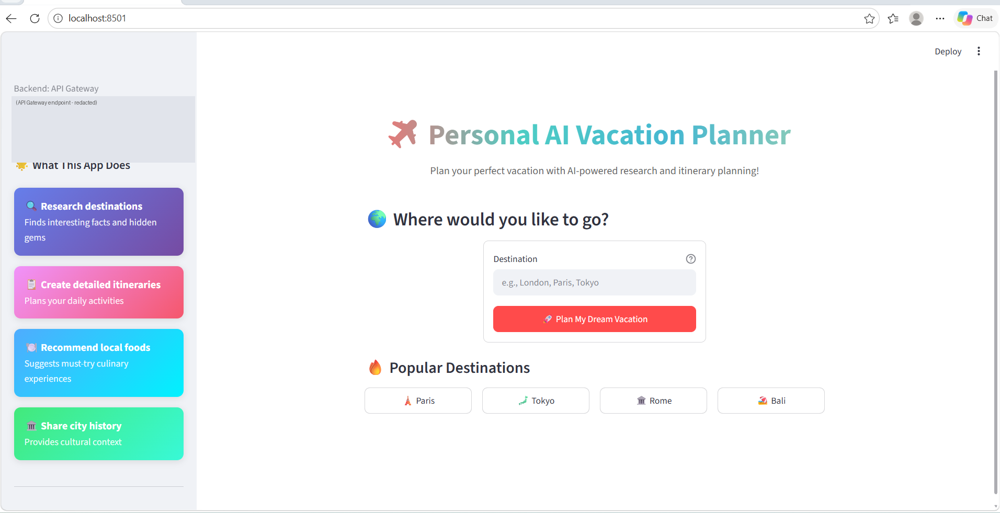
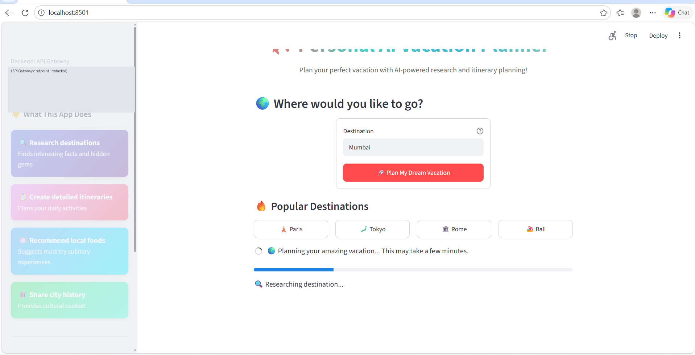
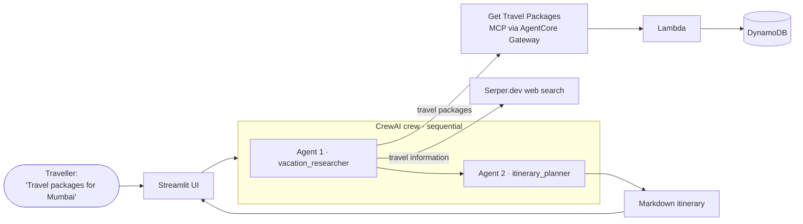
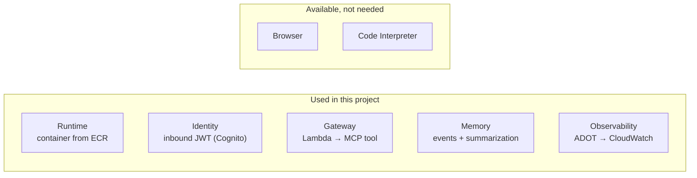
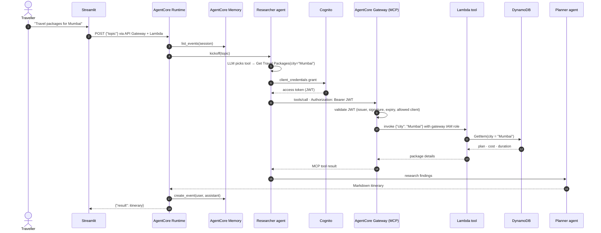
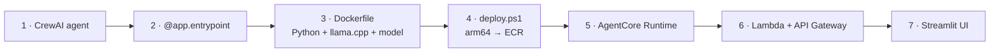

# ✈️ Personal Vacation Planner — Production Agentic AI on Amazon Bedrock AgentCore


This is a multi-agent AI travel planner that I designed, built and deployed end to end on AWS.

You ask for a destination or a package, for example *"Travel packages for Mumbai"*. The agent then:

1. Decides which tool the request needs.
2. Fetches the company's travel packages from DynamoDB through an OAuth-secured MCP gateway, or researches the destination on the web.
3. Returns a day-by-day itinerary.

The whole solution runs on AWS managed services: AgentCore Runtime, Gateway, Memory and Observability, plus Cognito, Lambda, DynamoDB, API Gateway, ECR and CloudWatch.

> 📸 Every claim in this README is backed by a numbered screenshot from my AWS account in [`evidence/`](evidence/). See [§8 Implementation evidence](#8-implementation-evidence).

## Highlights

- **Agentic AI in production on AgentCore Runtime.** A CrewAI multi-agent crew runs in a container on Amazon Bedrock AgentCore Runtime, which gives each session an isolated microVM.
- **Secure tool access.** The agent never touches the database. It calls a **Lambda tool exposed as MCP** through **AgentCore Gateway**, using a short-lived **Cognito OAuth 2.0 (M2M) JWT**.
- **Real AWS features.** It uses AgentCore Memory, ADOT/OpenTelemetry tracing, CloudWatch Transaction Search, Bedrock model invocation logging, and API Gateway with Lambda as a public API.
- **Engineered around a real constraint.** Bedrock token quotas blocked development, and AWS did not raise the limit. I re-architected to a **self-hosted LLM baked into the agent container**, which removed the quota dependency and per-token cost.
- **Validated end to end.** "Travel packages for Mumbai" returns the 5-day, USD 500–800 package from DynamoDB as a formatted itinerary.

## Demo

| Ask (backend: API Gateway) | Agent working | Result |
|---|---|---|
|  |  |  |

The Streamlit UI calls the deployed agent through **API Gateway → Lambda → AgentCore Runtime**. The itinerary combines the DynamoDB package with the agent's research.

---

## 1. Business problem

*Dream Vacation Planner*, a travel agency, wants to move from a proof of concept to production with an AI assistant on its website. The assistant must answer with two kinds of information:

| Need | Source | Requirement |
|---|---|---|
| The agency's **own travel packages** (plan, cost, duration) | DynamoDB, the internal system of record | Exact figures, with no direct database access from the LLM |
| **Destination knowledge** (attractions, history, food) | The public web | Fresh, broad coverage |

Production also needs authenticated tool access, conversation memory, monitoring, a public API, and repeatable container deployment. **Amazon Bedrock AgentCore** provides these as managed building blocks, which leaves the engineering effort for the agent itself.



## 2. My role and outcomes

I built this solo, from the agent code through to the AWS deployment:

| What I did | Evidence |
|---|---|
| Wrote the CrewAI agents, tasks and tools, and the AgentCore Runtime entrypoint (`crew.py`) | [30](evidence/30-runtime-console-test.png) |
| Set up a Cognito M2M identity, a JWT-secured AgentCore Gateway, a Lambda MCP target and the DynamoDB data | [01](evidence/01-cognito-m2m-app.png)–[21](evidence/21-gateway-mcp-smoke-test-gwtest.png) |
| Containerised the agent with a self-hosted LLM, cross-built it for arm64 and automated the push to ECR (`deploy.ps1`) | [22](evidence/22-deploy-ps1-build-push.png)–[24](evidence/24-ecr-images.png) |
| Deployed it to AgentCore Runtime and exposed it through API Gateway and a Lambda invoker | [25](evidence/25-runtime-create.png)–[41](evidence/41-api-postman-test.png) |
| Configured AgentCore Memory, ADOT tracing, CloudWatch Transaction Search and model invocation logging | [42](evidence/42-memory-create.png)–[49](evidence/49-cloudwatch-runtime-log-events.png) |
| Built the Streamlit UI, which switches between four backends: in-process, container, AgentCore or API Gateway | [50](evidence/50-streamlit-run-local.png)–[54](evidence/54-streamlit-mumbai-itinerary.png) |

**Outcomes:**
- The runtime `vacation_planner_agent` is **Active**, and a console test returns a full Vienna itinerary ([29](evidence/29-runtime-active.png), [30](evidence/30-runtime-console-test.png)).
- The Gateway target is **Ready**. An authenticated MCP `tools/list` call works ([19](evidence/19-gateway-target-ready.png), [21](evidence/21-gateway-mcp-smoke-test-gwtest.png)), and the Lambda returns the Mumbai package ([08](evidence/08-lambda-tool-test-mumbai.png)).
- The public API was tested from Postman and Lambda ([35](evidence/35-lambda-invoker-test-result.png), [41](evidence/41-api-postman-test.png)), and end to end from Streamlit ([54](evidence/54-streamlit-mumbai-itinerary.png)).
- CloudWatch shows traced, successful invocations ([49](evidence/49-cloudwatch-runtime-log-events.png)).

## 3. Solution architecture


### AgentCore capabilities used



### AWS features: what each one does and the proof

| AWS feature | What it does in this solution | Evidence |
|---|---|---|
| **AgentCore Runtime** | Hosts the agent container with session isolation (microVM, platform V2). The `BedrockAgentCoreApp` entrypoint serves `/invocations`. | [25](evidence/25-runtime-create.png)–[30](evidence/30-runtime-console-test.png) |
| **Amazon ECR** | Holds the arm64 image `vacation-planner:latest` (~957 MB, model included), with scan-on-push. | [23](evidence/23-ecr-first-push.png), [24](evidence/24-ecr-images.png) |
| **AgentCore Gateway** | Exposes the Lambda as an **MCP tool** (`get_travel_packages`, required `city`), with semantic search enabled. | [09](evidence/09-gateway-details.png), [12](evidence/12-gateway-target-mcp.png)–[14](evidence/14-gateway-target-inline-schema.png), [19](evidence/19-gateway-target-ready.png) |
| **Amazon Cognito** | Issues **OAuth 2.0 client-credentials** tokens to the agent. The gateway validates the JWT through the OIDC discovery URL and accepts only the agent's client. | [01](evidence/01-cognito-m2m-app.png)–[03](evidence/03-cognito-app-client.png), [10](evidence/10-gateway-inbound-jwt.png), [11](evidence/11-gateway-jwt-allowed-client.png) |
| **AWS Lambda** | Two functions: the **tool** (DynamoDB `GetItem` by `city`), and the **invoker** behind API Gateway (`invoke_agent_runtime`, 5-minute timeout). | [06](evidence/06-lambda-tool-create.png)–[08](evidence/08-lambda-tool-test-mumbai.png), [31](evidence/31-lambda-invoker-create.png)–[35](evidence/35-lambda-invoker-test-result.png) |
| **Amazon DynamoDB** | Package catalogue (`city` → `travel_plan`, `vacation_cost`, `duration`), on-demand capacity. | [04](evidence/04-dynamodb-table.png), [05](evidence/05-dynamodb-item-mumbai.png) |
| **AgentCore Memory** | Stores each user and assistant exchange per session (90-day events), with a Summarization long-term strategy. | [42](evidence/42-memory-create.png)–[45](evidence/45-memory-created.png) |
| **API Gateway** | Public REST `POST /vacation_planner` on the `prod` stage, with CORS. Browsers never hold AWS credentials. | [36](evidence/36-api-gateway-create.png)–[41](evidence/41-api-postman-test.png) |
| **Observability** | ADOT auto-instrumentation sends traces and logs to CloudWatch. Transaction Search and model invocation logging are enabled. | [46](evidence/46-cloudwatch-transaction-search.png)–[49](evidence/49-cloudwatch-runtime-log-events.png) |
| **IAM** | Separate execution roles for the tool Lambda, the gateway, the runtime and the invoker. | [07](evidence/07-lambda-tool-iam-role.png), [15](evidence/15-gateway-outbound-iam-role.png), [16](evidence/16-gateway-service-role-iam.png), [33](evidence/33-lambda-invoker-iam-role.png) |

## 4. How a request flows



**How the agent chooses a tool.** The research task in `config/tasks.yaml` gives the LLM an explicit routing rule:

```yaml
If the request is related to travel packages, use only the Get Travel Packages tool.
If the request is related to travel information, use only the Serper Search tool.
```

CrewAI shows the LLM each tool's name, description and argument schema. The model then emits a tool call. `get_travel_packages(city)` gets a Cognito token and sends an MCP `tools/call` to the gateway. The client secret only ever goes to Cognito, and the gateway sees only the short-lived JWT.

## 5. Key challenge: Bedrock token quotas → self-hosted LLM

**Problem.** The agent was first built on **Amazon Bedrock Nova Pro** through the APAC cross-region profile (`bedrock/apac.amazon.nova-pro-v1:0`), with model invocation logging enabled ([47](evidence/47-bedrock-model-invocation-logging.png)). A multi-agent crew makes many LLM calls per request, because of tool-use reasoning loops across two agents. That quickly hit the account's **Bedrock token quota and limit errors**. AWS did not approve the quota increase, which blocked development and testing.

**Decision.** I removed the dependency on per-token quotas by **packaging the LLM inside the agent's own container**. The agent still runs on AgentCore Runtime and uses every other AWS feature unchanged.

| Iteration | Result |
|---|---|
| Bedrock Nova Pro | Token quota and limit errors; increase not granted |
| Ollama (native, then Docker) with `llama3.1:8b` | Too heavy for development hardware (about 6–8 GB RAM); the Ollama image is about 8.5 GB |
| `llama3.2:3b` | Workable locally, but too large for a lean runtime image |
| **llama.cpp `llama-server` + Qwen2.5-0.5B-Instruct (Q4_K_M, about 400 MB), baked into the image** | Self-contained, CPU-only, no external LLM endpoint, quota or per-token cost |

**How it's built** (`Dockerfile`):

* **Stage 1:** `uv` installs a standalone CPython 3.11 and the dependencies: CrewAI, `bedrock-agentcore` and the ADOT distro.
* **Stage 2:** builds on the official llama.cpp server image (multi-arch, no GPU libraries), copies in the model and runs as a non-root user.
* **One `CMD` starts two processes:** `llama-server` on `127.0.0.1:8081`, reachable only inside the container, and the AgentCore app under `opentelemetry-instrument`.
* **CrewAI connects** through the OpenAI-compatible API (`MODEL=openai/qwen2.5-0.5b`, `LLM_BASE_URL=http://127.0.0.1:8081/v1`).
* **Image size:** I replaced the `crewai[tools]` extra with a small custom Serper tool, which cut more than 1 GB.
* **Platform:** `deploy.ps1` cross-builds for **linux/arm64**, because AgentCore runs on Graviton, and pushes to ECR ([22](evidence/22-deploy-ps1-build-push.png)).



**Trade-off.** CPU inference on a 0.5B model is slower and less capable than Nova Pro. I mitigated this with temperature 0.3, explicit tool-routing instructions and a 5-minute invoker timeout ([32](evidence/32-lambda-invoker-timeout.png)). **Switching back to Bedrock is a one-line change** in `crew.py`, and the model is configured entirely through environment variables.

## 6. Other engineering challenges solved

| Challenge | Resolution | Evidence |
|---|---|---|
| **ADOT crashed every crew run.** The ADOT 0.22 CrewAI instrumentor reads event fields that crewai 0.193 doesn't emit. | Disabled only that instrumentor (`OTEL_PYTHON_DISABLED_INSTRUMENTATIONS=aws_crewai`) and kept HTTP, botocore and LLM-client tracing. | [48](evidence/48-cloudwatch-runtime-log-streams.png), [49](evidence/49-cloudwatch-runtime-log-events.png) |
| **Gateway target rejected.** The name `target-travel_agent_toolp` failed the `([0-9a-zA-Z][-]?){1,100}` rule. | Renamed it `target-travel-agent-tool`. The agent calls `target-travel-agent-tool__get_travel_packages`. | [18](evidence/18-gateway-target-name-validation.png), [19](evidence/19-gateway-target-ready.png) |
| **Proving the gateway before wiring in the agent** | Wrote `src/GWTEST/gwtest.py` (Cognito token → `tools/list` → `tools/call`), starting from the console's generated client code. | [20](evidence/20-gateway-view-code.png), [21](evidence/21-gateway-mcp-smoke-test-gwtest.png) |
| **arm64 image built on an x86 Windows PC** | A buildx `docker-container` builder with `--platform linux/arm64 --provenance=false`, scripted in `deploy.ps1`. | [22](evidence/22-deploy-ps1-build-push.png) |
| **Long agent runs timing out** | Raised the invoker Lambda timeout from 3 seconds to 5 minutes. The UI waits up to 900 seconds. | [32](evidence/32-lambda-invoker-timeout.png) |
| **AgentCore session ID rules** (33+ characters) | The invoker Lambda and the UI generate UUID-based runtime session IDs. | [35](evidence/35-lambda-invoker-test-result.png) |
| **Secrets** | All configuration comes from environment variables. `.env` is excluded from the image and from git, and the LLM never sees credentials. | — |

## 7. Technology stack

| Layer | Technology |
|---|---|
| Agents | Python 3.11, CrewAI (sequential two-agent crew, custom `BaseTool` and `@tool`) |
| LLM | Self-hosted Qwen2.5-0.5B-Instruct on llama.cpp. Bedrock Nova Pro can be restored with one line. |
| Agent platform | Amazon Bedrock AgentCore: Runtime, Gateway (MCP), Memory, Observability |
| Identity | Amazon Cognito: OAuth 2.0 client credentials and JWT |
| Backend | AWS Lambda, Amazon DynamoDB, Amazon API Gateway |
| Delivery | Docker multi-stage build (arm64), Amazon ECR, PowerShell deployment script |
| Observability | AWS Distro for OpenTelemetry, Amazon CloudWatch |
| UI | Streamlit |

## 8. Implementation evidence

These 54 screenshots come from my AWS account and development machine, numbered in **build order**. Account IDs, ARNs, Cognito, Gateway and API IDs, and an access token are redacted. Expand a stage to see what each screenshot proves.

<details>
<summary><b>1 · Identity: Amazon Cognito (01–03)</b></summary>

| # | Screenshot | What it shows |
|---|---|---|
| 01 | [Cognito M2M app](evidence/01-cognito-m2m-app.png) | Application `vacation_planner_agent` created as **Machine-to-machine**. The agent authenticates as a service through the client-credentials grant. |
| 02 | [User pool](evidence/02-cognito-user-pool.png) | User pool with its OIDC configuration URL, which AgentCore Gateway uses to validate JWTs |
| 03 | [App client](evidence/03-cognito-app-client.png) | App client with a secret and 60-minute access tokens. The credentials reach the agent through environment variables. |
</details>

<details>
<summary><b>2 · Data: DynamoDB (04–05)</b></summary>

| # | Screenshot | What it shows |
|---|---|---|
| 04 | [Table](evidence/04-dynamodb-table.png) | `travel_packages`, partition key `city` (S), on-demand |
| 05 | [Mumbai item](evidence/05-dynamodb-item-mumbai.png) | `city`, `duration`, `travel_plan`, `vacation_cost`: the record behind "Travel packages for Mumbai" |
</details>

<details>
<summary><b>3 · Tool: Lambda, DynamoDB reader (06–08)</b></summary>

| # | Screenshot | What it shows |
|---|---|---|
| 06 | [Create function](evidence/06-lambda-tool-create.png) | `bedrock_agentcore_travel_tool`; code in `src/lambda/lambdatravel_package_getdata.py` |
| 07 | [IAM role](evidence/07-lambda-tool-iam-role.png) | Execution role with DynamoDB access (a broad PoC policy; least privilege is on the roadmap) |
| 08 | [Test: Mumbai](evidence/08-lambda-tool-test-mumbai.png) | `get_item` returns the Mumbai package (`statusCode: 200`), proving the tool before it goes behind the gateway |
</details>

<details>
<summary><b>4 · AgentCore Gateway: Lambda as an MCP tool (09–21)</b></summary>

| # | Screenshot | What it shows |
|---|---|---|
| 09 | [Gateway details](evidence/09-gateway-details.png) | `gateway-vacation-planner`, with semantic tool search and exception-level debugging enabled |
| 10 | [Inbound JWT](evidence/10-gateway-inbound-jwt.png) | Inbound auth set to **JSON Web Tokens** through the Cognito discovery URL |
| 11 | [Allowed client](evidence/11-gateway-jwt-allowed-client.png) | Only the agent's Cognito client may call the gateway |
| 12 | [MCP target](evidence/12-gateway-target-mcp.png) | Target protocol: **MCP** |
| 13 | [Lambda ARN](evidence/13-gateway-target-lambda-arn.png) | Target type: **Lambda ARN**, pointing at the tool function |
| 14 | [Inline schema](evidence/14-gateway-target-inline-schema.png) | `get_travel_packages` with a required `city`, the same contract as `src/lambda/openAPI_schema.json` |
| 15 | [Outbound IAM](evidence/15-gateway-outbound-iam-role.png) | Outbound auth through an **IAM role**: the gateway invokes Lambda with its own role |
| 16 | [Service role](evidence/16-gateway-service-role-iam.png) | The gateway's IAM service role (admin policy for PoC speed) |
| 17 | [Review](evidence/17-gateway-review-create.png) | Summary: JWT inbound, MCP target, `lambdaArn` |
| 18 | [Name validation](evidence/18-gateway-target-name-validation.png) | **Challenge:** target names can't contain underscores, so I renamed the target `target-travel-agent-tool` |
| 19 | [Target ready](evidence/19-gateway-target-ready.png) | `target-travel-agent-tool`: **Ready**, MCP, Lambda |
| 20 | [View code](evidence/20-gateway-view-code.png) | The console's generated client code, the starting point for `gwtest.py` |
| 21 | [MCP smoke test](evidence/21-gateway-mcp-smoke-test-gwtest.png) | `python gwtest.py`: token → `tools/list` JSON-RPC response (token redacted) |
</details>

<details>
<summary><b>5 · Container build: Docker → ECR (22–24)</b></summary>

| # | Screenshot | What it shows |
|---|---|---|
| 22 | [deploy.ps1](evidence/22-deploy-ps1-build-push.png) | One command: ECR login, arm64 buildx push and a digest check |
| 23 | [ECR first push](evidence/23-ecr-first-push.png) | `vacation-planner` repository with the first images (16 Nov) |
| 24 | [ECR images](evidence/24-ecr-images.png) | The rebuilt `latest` image (~957 MB, model included) after later code changes |
</details>

<details>
<summary><b>6 · AgentCore Runtime (25–30)</b></summary>

| # | Screenshot | What it shows |
|---|---|---|
| 25 | [Create runtime](evidence/25-runtime-create.png) | `vacation_planner_agent`, platform **V2**, **microVM** compute, consumption-based capacity |
| 26 | [ECR source](evidence/26-runtime-ecr-source.png) | Agent source: **ECR container** `vacation-planner:latest` |
| 27 | [Inbound auth](evidence/27-runtime-inbound-auth.png) | HTTP protocol with IAM inbound auth: callers use SigV4 |
| 28 | [Advanced config](evidence/28-runtime-advanced-config.png) | Public network, 15-minute idle timeout, 8-hour maximum lifetime |
| 29 | [Active](evidence/29-runtime-active.png) | Status **Active**, with a DEFAULT endpoint |
| 30 | [Console test](evidence/30-runtime-console-test.png) | `{"topic": "Plan a vacation to Vienna, Austria"}` → `{"result": ...}` from `agent_invocation` |
</details>

<details>
<summary><b>7 · Public API: Lambda invoker + API Gateway (31–41)</b></summary>

| # | Screenshot | What it shows |
|---|---|---|
| 31 | [Invoker Lambda](evidence/31-lambda-invoker-create.png) | `vacation_planner`; code in `src/lambda/lambda_function.py` |
| 32 | [Timeout](evidence/32-lambda-invoker-timeout.png) | Timeout raised to 5 minutes 3 seconds for long agent runs |
| 33 | [IAM role](evidence/33-lambda-invoker-iam-role.png) | `BedrockAgentCoreFullAccess`, needed for `invoke_agent_runtime` |
| 34 | [Test event](evidence/34-lambda-invoker-test-event.png) | `{"prompt": "Tokyo"}` |
| 35 | [Test result](evidence/35-lambda-invoker-test-result.png) | `200`, CORS headers, `session_id` and the Tokyo itinerary: the Lambda → Runtime round trip |
| 36 | [REST API](evidence/36-api-gateway-create.png) | REST API `vacation_planner` (Regional) |
| 37 | [Resource](evidence/37-api-gateway-resource.png) | `/vacation_planner` with **CORS** enabled |
| 38 | [POST → Lambda](evidence/38-api-gateway-post-lambda.png) | POST method with Lambda integration |
| 39 | [Deploy](evidence/39-api-gateway-deploy.png) | Deployed to the `prod` stage |
| 40 | [Stage](evidence/40-api-gateway-prod-stage.png) | `prod` stage tree and invoke URL |
| 41 | [Postman](evidence/41-api-postman-test.png) | `POST /prod/vacation_planner` with `{"prompt": "Plan a vacation to Zurich, Switzerland"}` |
</details>

<details>
<summary><b>8 · AgentCore Memory (42–45)</b></summary>

| # | Screenshot | What it shows |
|---|---|---|
| 42 | [Create memory](evidence/42-memory-create.png) | `vacation_planner_demo`, with 90-day short-term events, used by `load_previous_conversations()` and `save_conversation()` |
| 43 | [Summarization](evidence/43-memory-summarization-strategy.png) | Built-in **Summarization** long-term strategy, namespaced per actor and session |
| 44 | [Strategies](evidence/44-memory-strategies.png) | `summary_builtin_…` configured, set to never expire |
| 45 | [Created](evidence/45-memory-created.png) | Memory resource created |
</details>

<details>
<summary><b>9 · Observability (46–49)</b></summary>

| # | Screenshot | What it shows |
|---|---|---|
| 46 | [Transaction Search](evidence/46-cloudwatch-transaction-search.png) | OpenTelemetry spans ingested as structured logs |
| 47 | [Model invocation logging](evidence/47-bedrock-model-invocation-logging.png) | Bedrock invocations logged to CloudWatch (during the Nova Pro phase) |
| 48 | [Log streams](evidence/48-cloudwatch-runtime-log-streams.png) | Runtime log group with `otel-rt-logs`, runtime and build streams |
| 49 | [Log events](evidence/49-cloudwatch-runtime-log-events.png) | Execution-trace banner, `Invocation completed successfully`, trace and span IDs |
</details>

<details>
<summary><b>10 · Streamlit UI (50–54)</b></summary>

| # | Screenshot | What it shows |
|---|---|---|
| 50 | [streamlit run](evidence/50-streamlit-run-local.png) | Launching the UI from VS Code, with the project structure visible |
| 51 | [Local mode](evidence/51-streamlit-local-planning.png) | Planning "London" with the in-process crew |
| 52 | [API Gateway backend](evidence/52-streamlit-api-gateway-backend.png) | The same UI switched to the AWS stack through `API_GATEWAY_URL` |
| 53 | [Agent working](evidence/53-streamlit-agent-planning.png) | Mumbai request in progress |
| 54 | [Mumbai itinerary](evidence/54-streamlit-mumbai-itinerary.png) | **Final result:** cost USD 500–800 over 5 days with a day-by-day plan, from DynamoDB through Gateway, Lambda and Runtime |
</details>

## 9. Roadmap

- Move the deployed model back to Bedrock (Nova or Claude) once quota allows, for faster and stronger tool use.
- Feed AgentCore Memory history into the prompts, use a stable per-user session ID, and add long-term preference memory.
- Discover tools dynamically from the Gateway's `tools/list`, and cache Cognito tokens until they expire.
- Tighten IAM to least privilege: `dynamodb:GetItem` for the tool Lambda, and `lambda:InvokeFunction` only for the gateway role.
- Infrastructure as code (CDK or Terraform) and a CI pipeline for build, push and runtime update.
- More tools behind the same gateway: weather, flights and hotels.

## 10. Run it yourself

```powershell
copy .env.example .env                  # fill in your own values (git-ignored)
crewai install
crewai run                              # local crew (Ollama) → report.md
uv run streamlit run streamlitui.py     # UI; backend chosen by API_GATEWAY_URL / AGENTCORE_RUNTIME_ARN / AGENT_URL
uv run python src/GWTEST/gwtest.py      # Cognito + MCP gateway smoke test
.\deploy.ps1                            # build the arm64 image and push it to ECR (set $ACCOUNT / $REGION first)
```

All configuration is in [`.env.example`](.env.example): the model, Serper key, region, AgentCore Memory ID, Cognito client, Gateway URL and tool name, and the UI backend. The Lambda functions read `AGENT_RUNTIME_ARN`, `AGENT_RUNTIME_QUALIFIER` and `TRAVEL_PACKAGES_TABLE` from their own environment variables.

```
src/vacation_planner/crew.py         AgentCore entrypoint, agents, Gateway + Memory helpers
src/vacation_planner/config/         agents.yaml, tasks.yaml (tool routing)
src/vacation_planner/tools/          SerperSearchTool
src/lambda/                          tool Lambda, invoker Lambda, MCP tool schema
src/GWTEST/gwtest.py                 Cognito + MCP smoke test
streamlitui.py                       UI (4 backend modes)
Dockerfile · deploy.ps1              arm64 image with self-hosted LLM → ECR
evidence/                            54 numbered implementation screenshots
```
