# ✈️ Personal Vacation Planner — Production Agentic AI on Amazon Bedrock AgentCore


This is a multi-agent AI travel planner that I designed, built and deployed end to end on AWS.

You ask for a destination or a package, for example *"Travel packages for Mumbai"*. The agent then:

1. Decides which tool the request needs.
2. Fetches the company's travel packages from DynamoDB through an OAuth-secured MCP gateway, or researches the destination on the web.
3. Returns a day-by-day itinerary.

The whole solution runs on AWS managed services: AgentCore Runtime, Gateway, Memory and Observability, plus Cognito, Lambda, DynamoDB, API Gateway, ECR and CloudWatch.

## Highlights

- **Agentic AI in production on AgentCore Runtime.** A CrewAI multi-agent crew runs in a container on Amazon Bedrock AgentCore Runtime, which gives each session an isolated microVM.
- **Secure tool access.** The agent never touches the database. It calls a **Lambda tool exposed as MCP** through **AgentCore Gateway**, using a short-lived **Cognito OAuth 2.0 (M2M) JWT**.
- **Real AWS features.** It uses AgentCore Memory, ADOT/OpenTelemetry tracing, CloudWatch Transaction Search, Bedrock model invocation logging, and API Gateway with Lambda as a public API.
- **Engineered around a real constraint.** Bedrock token quotas blocked development, and AWS did not raise the limit. I re-architected to a **self-hosted LLM baked into the agent container**, which removed the quota dependency and per-token cost.
- **Validated end to end.** "Travel packages for Mumbai" returns the 5-day, USD 500–800 package from DynamoDB as a formatted itinerary.

## Demo

| Ask | Agent working | Result |
|---|---|---|
|  |  | 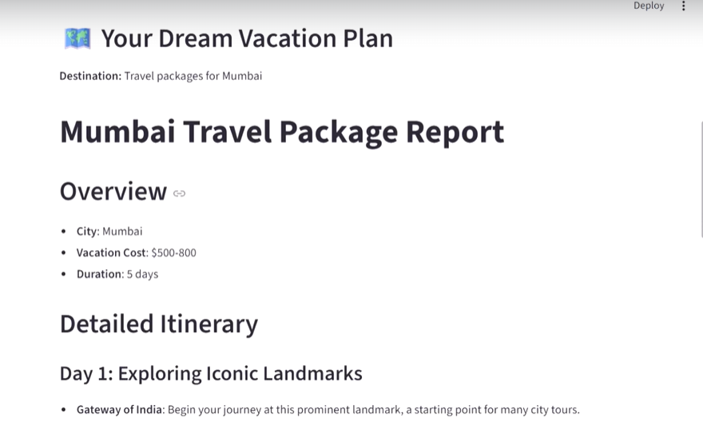 |

The Streamlit UI is calling the deployed agent through **API Gateway → Lambda → AgentCore Runtime**. The itinerary combines the DynamoDB package with the agent's research.

---

## 1. Business problem

*Dream Vacation Planner*, a travel agency, wants to move from a proof of concept to production with an AI assistant on its website. The assistant must answer with two kinds of information:

| Need | Source | Requirement |
|---|---|---|
| The agency's **own travel packages** (plan, cost, duration) | DynamoDB, the internal system of record | Exact figures, with no direct database access from the LLM |
| **Destination knowledge** (attractions, history, food) | The public web | Fresh, broad coverage |

Production also needs authenticated tool access, conversation memory, monitoring, a public API, and repeatable container deployment. **Amazon Bedrock AgentCore** provides these as managed building blocks, which leaves the engineering effort for the agent itself.

## 2. My role and outcomes

I built this solo, from the agent code through to the AWS deployment:

- Wrote the CrewAI agents, tasks and tools, and the AgentCore Runtime entrypoint.
- Built the Gateway tool path:
  - a Cognito M2M app client;
  - JWT inbound authentication on the gateway;
  - a Lambda target with its MCP tool schema;
  - the DynamoDB table and data.
- Containerised the agent with a self-hosted LLM, cross-built it for arm64 and automated the push to ECR (`deploy.ps1`).
- Deployed it to AgentCore Runtime and exposed it through API Gateway and a Lambda invoker.
- Added AgentCore Memory and ADOT observability, and enabled CloudWatch Transaction Search and model invocation logging.
- Built the Streamlit UI, which can switch between four backends: in-process, local container, AgentCore directly, or API Gateway.

**Outcomes:**
- The runtime `vacation_planner_agent` is **Active**. A console test with `{"topic": "Plan a vacation to Vienna, Austria"}` returns a full itinerary.
- The Gateway target `target-travel-agent-tool` is **Ready**. An authenticated MCP `tools/list` and `tools/call` return the Mumbai package from DynamoDB.
- The public API was validated end to end from Streamlit, and CloudWatch logs `Invocation completed successfully`.

## 3. Solution architecture

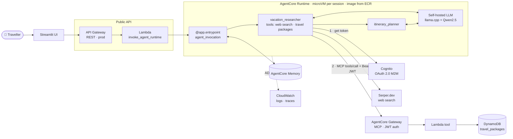

### AWS features used and why

| AWS feature | What it does in this solution |
|---|---|
| **AgentCore Runtime** | Hosts the agent container with session isolation (microVM). The `BedrockAgentCoreApp` entrypoint serves `/invocations`. |
| **Amazon ECR** | Holds the arm64 agent image `vacation-planner:latest`, with scan-on-push. |
| **AgentCore Gateway** | Exposes the Lambda as an **MCP tool** (`get_travel_packages`). The agent speaks standard JSON-RPC and needs no AWS SDK for the data plane. |
| **Amazon Cognito** | Issues **OAuth 2.0 client-credentials** tokens to the agent, a machine identity rather than a user. The gateway validates the JWT through the Cognito OpenID discovery URL. |
| **AWS Lambda** | Two functions: the **tool** (DynamoDB `GetItem` by `city`), and the **invoker** behind API Gateway (`invoke_agent_runtime`). |
| **Amazon DynamoDB** | Stores the package catalogue (`city` → plan, cost, duration). On-demand capacity and exact key lookups mean no approximate answers. |
| **AgentCore Memory** | Stores each user and assistant exchange per session. Short-term events expire after 90 days, and a Summarization long-term strategy is configured. |
| **API Gateway** | Public REST `POST /vacation_planner` on the `prod` stage, with CORS. Browsers never hold AWS credentials. |
| **Observability** | ADOT auto-instrumentation (`opentelemetry-instrument`) sends traces and logs to CloudWatch. Transaction Search and Bedrock model invocation logging are both enabled. |
| **IAM** | Separate execution roles for the runtime, the gateway, the tool Lambda and the invoker Lambda. |

## 4. How a request flows

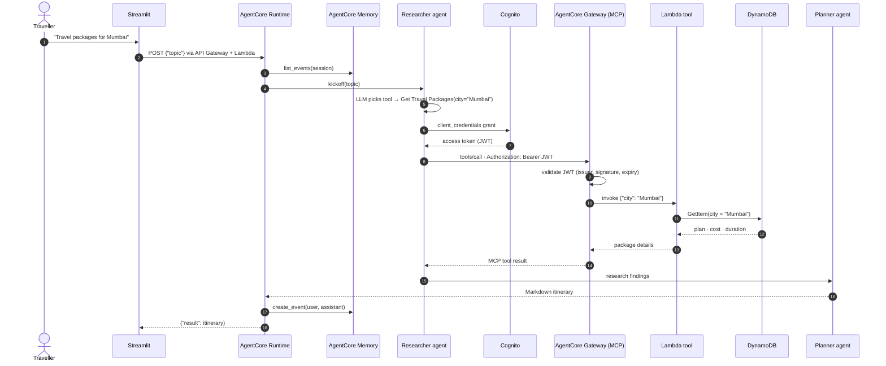

**How the agent chooses a tool.** The research task in `config/tasks.yaml` gives the LLM an explicit routing rule:

```yaml
If the request is related to travel packages, use only the Get Travel Packages tool.
If the request is related to travel information, use only the Serper Search tool.
```

CrewAI shows the LLM each tool's name, description and argument schema. The model then emits a tool call. For packages, `get_travel_packages(city)` gets a Cognito token and sends an MCP `tools/call` to the gateway. The second agent turns the findings into the final report.

## 5. Key challenge: Bedrock token quotas → self-hosted LLM

**Problem.** The agent was first built on **Amazon Bedrock Nova Pro** through the APAC cross-region profile (`bedrock/apac.amazon.nova-pro-v1:0`). A multi-agent crew makes many LLM calls per request, because of tool-use reasoning loops across two agents. That quickly hit the account's **Bedrock token quota and limit errors**. AWS did not approve the quota increase, which blocked development and testing.

**Decision.** I removed the dependency on per-token quotas by **packaging the LLM inside the agent's own container**. The agent still runs on AgentCore Runtime and uses every other AWS feature unchanged.

| Iteration | Result |
|---|---|
| Bedrock Nova Pro | Token quota and limit errors; increase not granted |
| Ollama (native, then Docker) with `llama3.1:8b` | Too heavy for development hardware (about 6–8 GB RAM); the Ollama image is about 8.5 GB |
| `llama3.2:3b` | Workable locally, but too large for a lean runtime image |
| **llama.cpp `llama-server` + Qwen2.5-0.5B-Instruct (Q4_K_M, about 400 MB), baked into the image** | Self-contained, CPU-only, no external LLM endpoint, quota or per-token cost |

**How it's built** (`Dockerfile`):

* **Stage 1:** `uv` installs a standalone CPython 3.11 and the dependencies: CrewAI, `bedrock-agentcore` and the ADOT distro.
* **Stage 2:** builds on the official llama.cpp server image (multi-arch, no GPU libraries), copies in the model and runs as a non-root user.
* **One `CMD` starts two processes:** `llama-server` on `127.0.0.1:8081`, reachable only inside the container, and the AgentCore app under `opentelemetry-instrument`.
* **CrewAI connects** through the OpenAI-compatible API (`MODEL=openai/qwen2.5-0.5b`, `LLM_BASE_URL=http://127.0.0.1:8081/v1`).
* **Image size:** I replaced the `crewai[tools]` extra with a small custom Serper tool, which cut more than 1 GB. The final image is about 957 MB, including the model.
* **Platform:** `deploy.ps1` cross-builds for **linux/arm64**, because AgentCore runs on Graviton, and pushes to ECR.

**Trade-off.** CPU inference on a 0.5B model is slower and less capable than Nova Pro. I mitigated this with temperature 0.3 and explicit tool-routing instructions. **Switching back to Bedrock is a one-line change** in `crew.py`, and the commented `LLM(model="bedrock/...")` line is kept for that. The model is configured entirely through environment variables.

## 6. Other engineering challenges solved

| Challenge | Resolution |
|---|---|
| **ADOT crashed every crew run.** The ADOT 0.22 CrewAI instrumentor reads event fields that crewai 0.193 doesn't emit. | Disabled only that instrumentor (`OTEL_PYTHON_DISABLED_INSTRUMENTATIONS=aws_crewai`) and kept HTTP, botocore and LLM-client tracing. |
| **Gateway target rejected.** The name `target-travel_agent_toolp` failed the `([0-9a-zA-Z][-]?){1,100}` rule. | Renamed it `target-travel-agent-tool`. The agent calls the namespaced tool `target-travel-agent-tool__get_travel_packages`. |
| **arm64 image built on an x86 Windows PC** | A buildx `docker-container` builder with `--platform linux/arm64 --provenance=false`, scripted in `deploy.ps1`. |
| **AgentCore session ID rules** (33+ characters) | The invoker Lambda and the UI generate UUID-based runtime session IDs. |
| **API Gateway non-proxy responses** | The UI unwraps the `{"statusCode", "body"}` envelope transparently. |
| **Secrets** | All configuration comes from environment variables. `.env` is excluded from the image (`.dockerignore`) and from git, and the LLM never sees credentials. |

## 7. Technology stack

| Layer | Technology |
|---|---|
| Agents | Python 3.11, CrewAI (sequential two-agent crew, custom `BaseTool` and `@tool`) |
| LLM | Self-hosted Qwen2.5-0.5B-Instruct on llama.cpp. Bedrock Nova Pro can be restored with one line. |
| Agent platform | Amazon Bedrock AgentCore: Runtime, Gateway (MCP), Memory, Observability |
| Identity | Amazon Cognito: OAuth 2.0 client credentials and JWT |
| Backend | AWS Lambda, Amazon DynamoDB, Amazon API Gateway |
| Delivery | Docker multi-stage build (arm64), Amazon ECR, PowerShell deployment script |
| Observability | AWS Distro for OpenTelemetry, Amazon CloudWatch |
| UI | Streamlit |

## 8. AWS console evidence

These screenshots come from my AWS account. Account IDs, ARNs and client IDs are redacted.

<details>
<summary><b>AgentCore Runtime and ECR</b></summary>

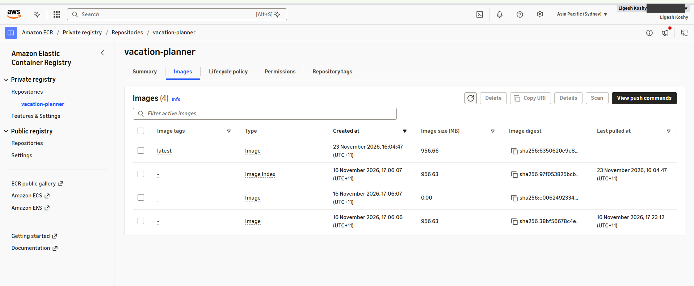
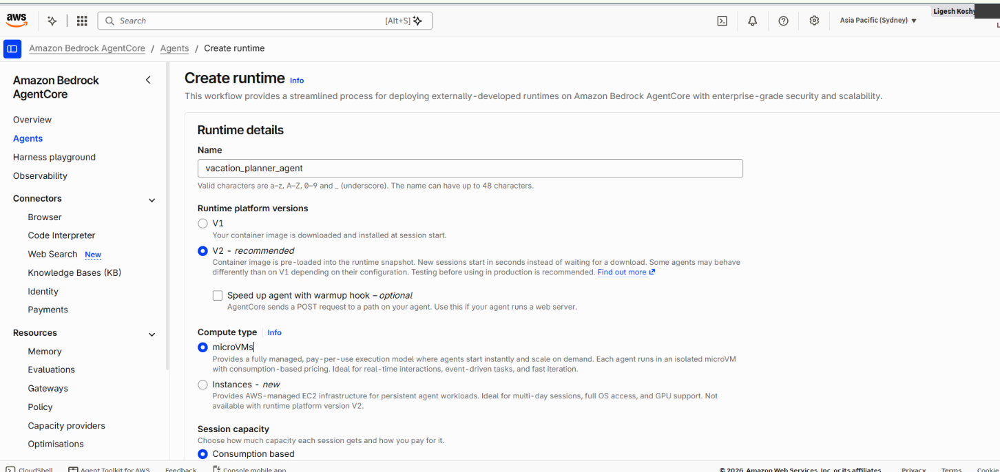
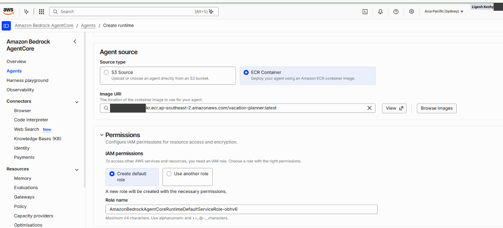
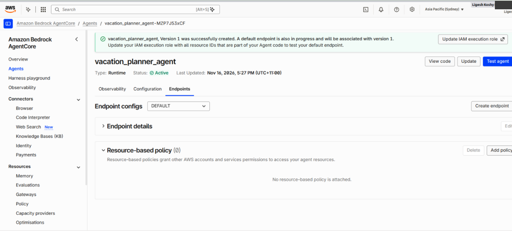
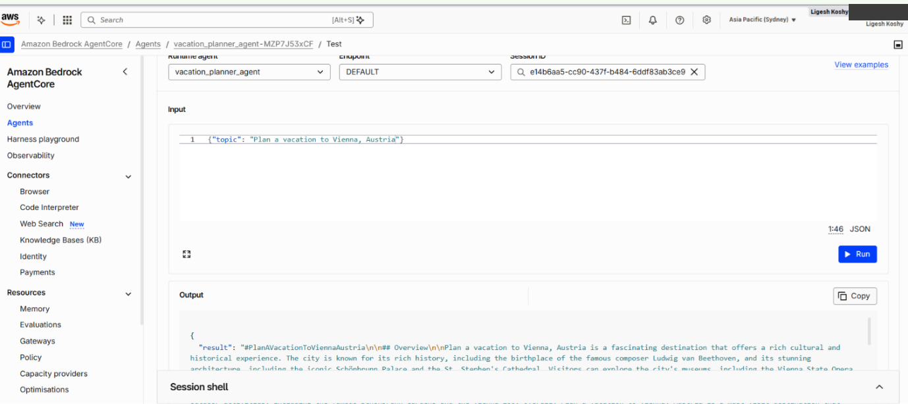
</details>

<details>
<summary><b>Cognito and AgentCore Gateway (MCP)</b></summary>

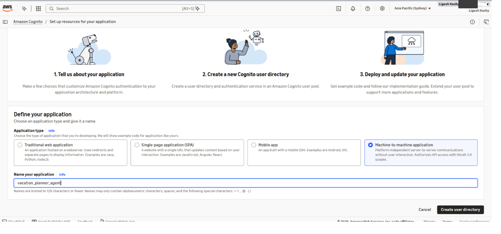
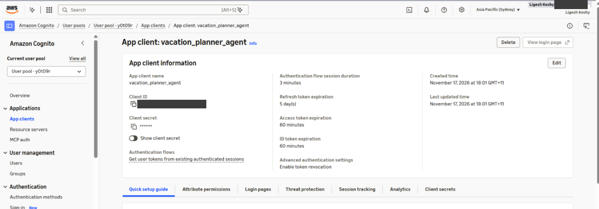
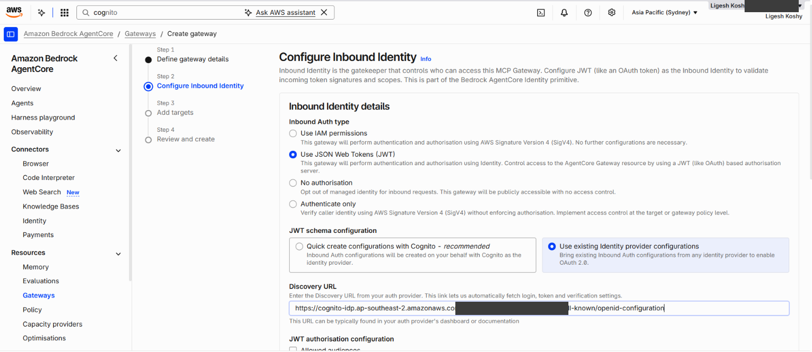
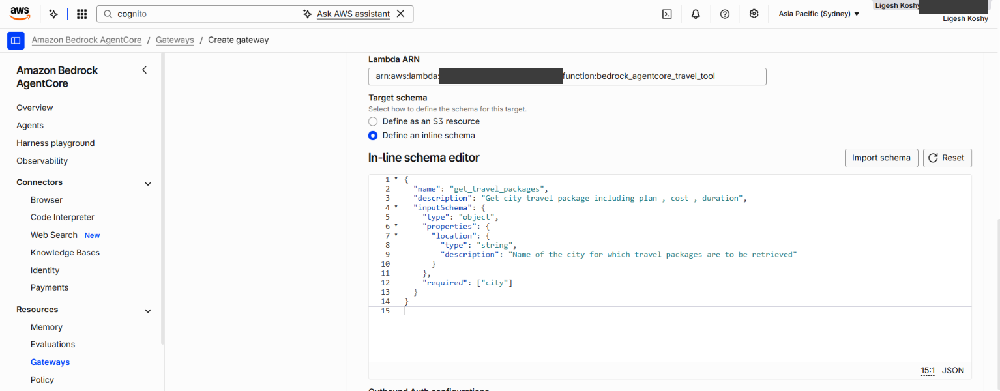
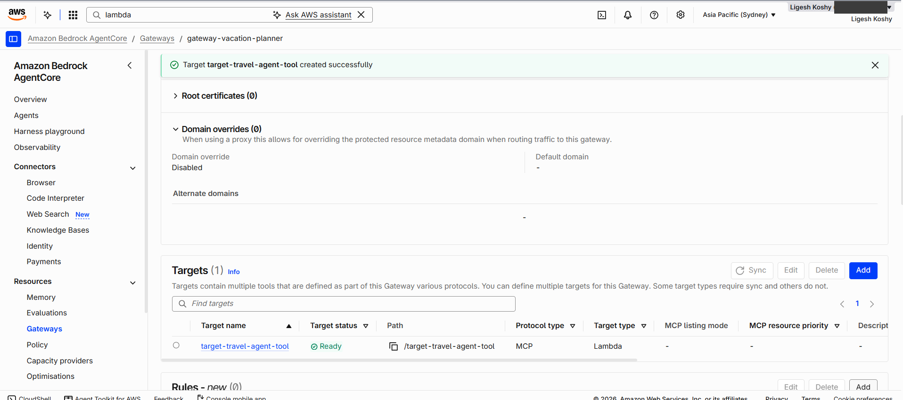
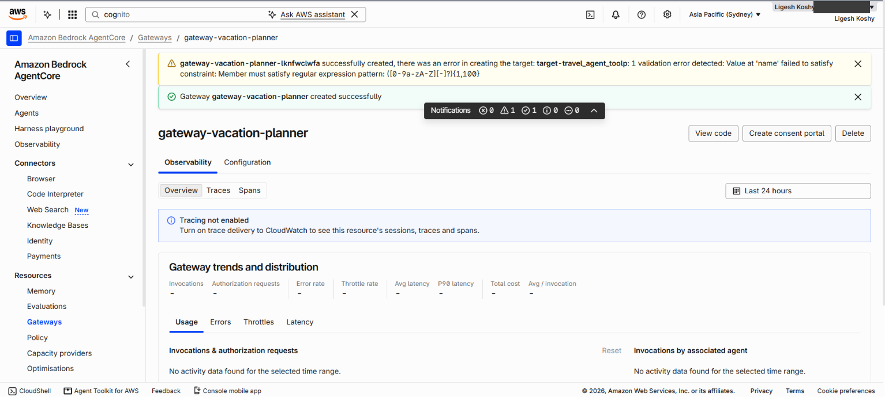
</details>

<details>
<summary><b>DynamoDB, Lambda and API Gateway</b></summary>

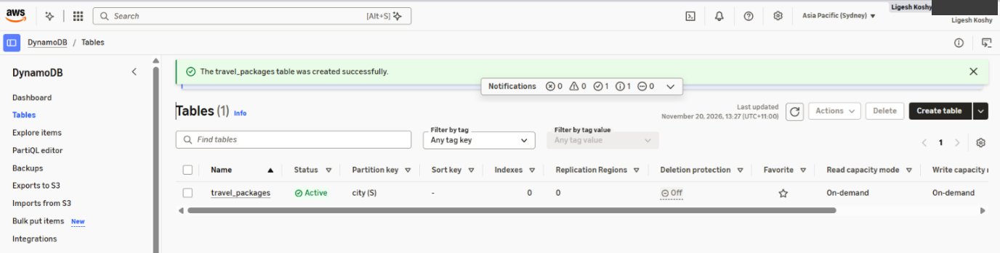
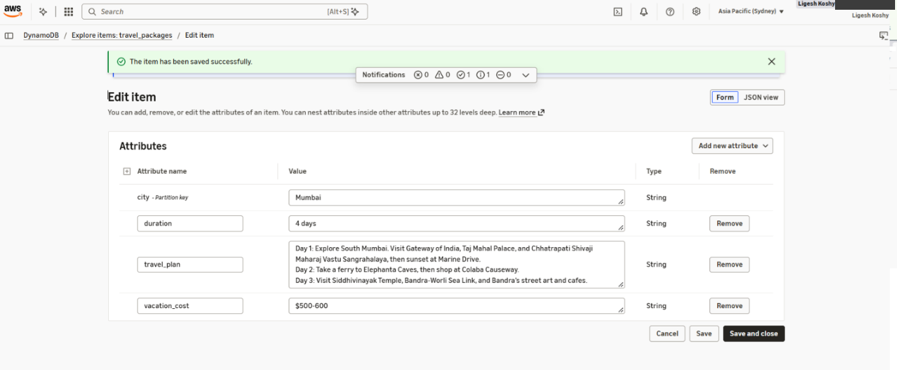
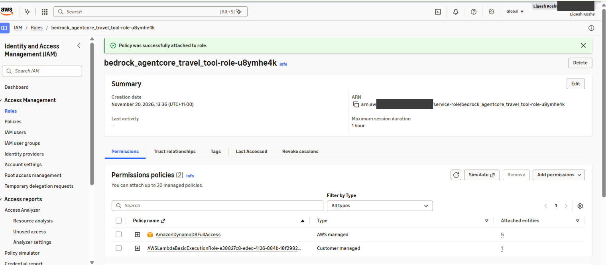
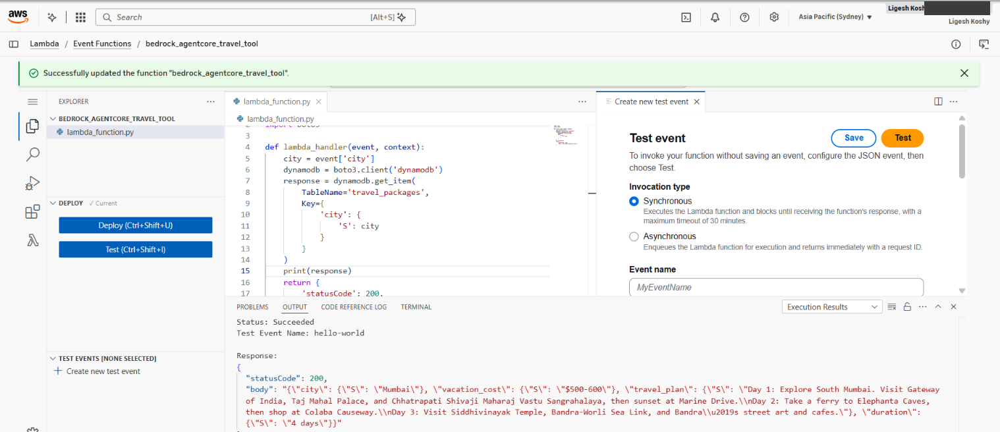
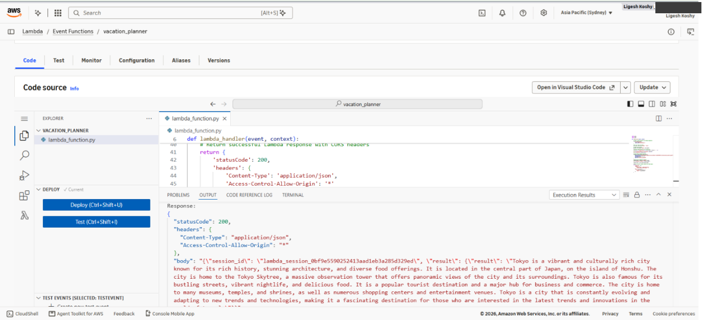
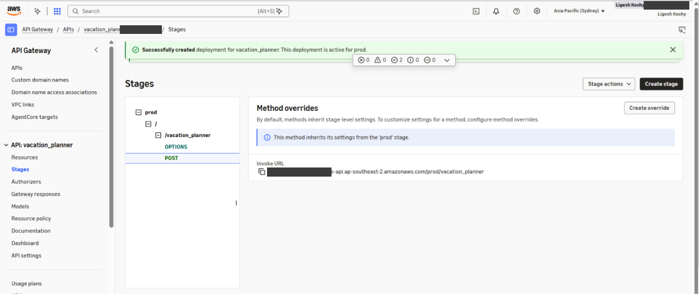
</details>

<details>
<summary><b>AgentCore Memory</b></summary>

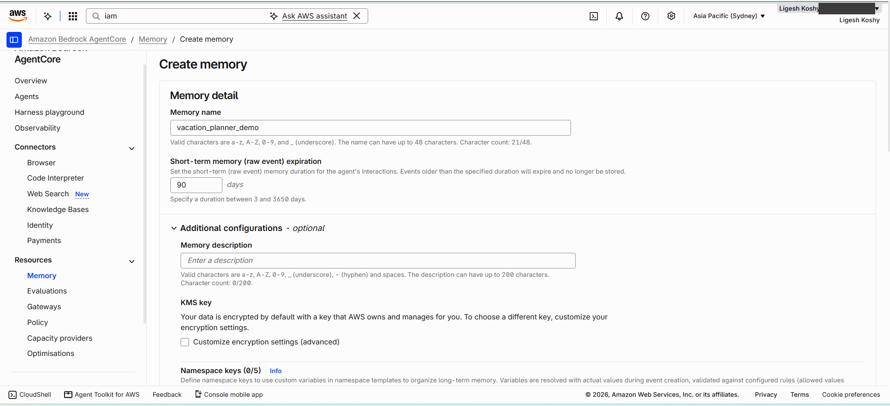
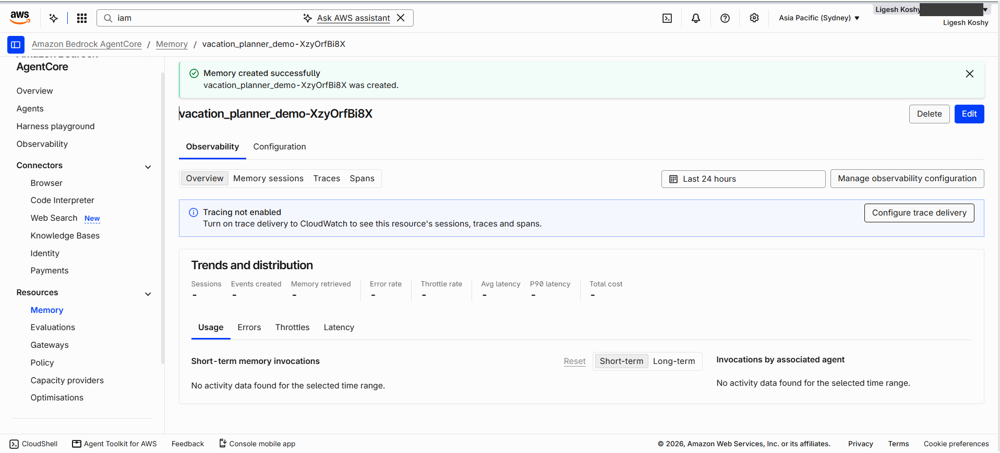
</details>

<details>
<summary><b>Observability</b></summary>

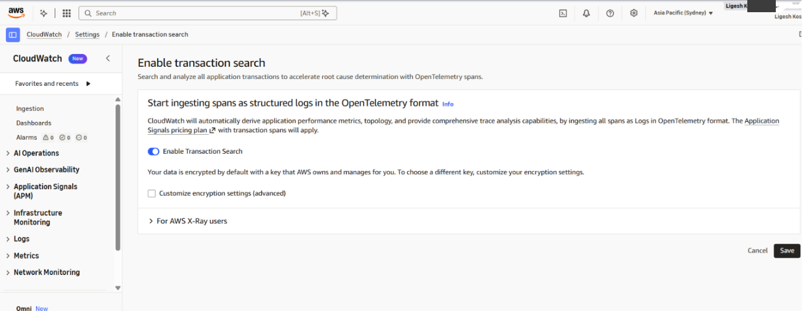
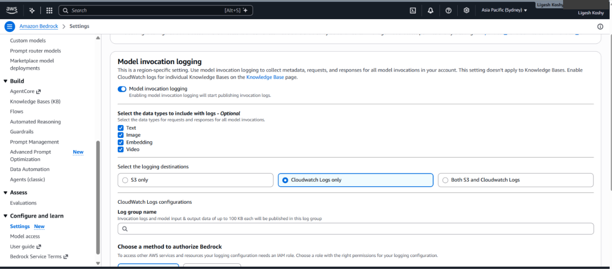
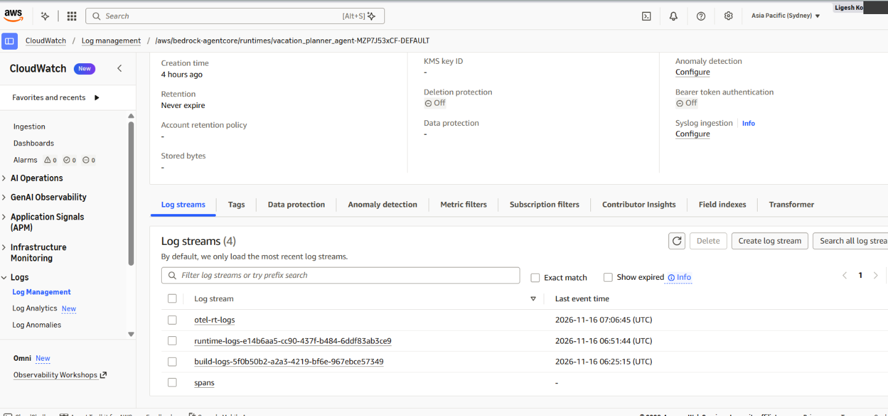
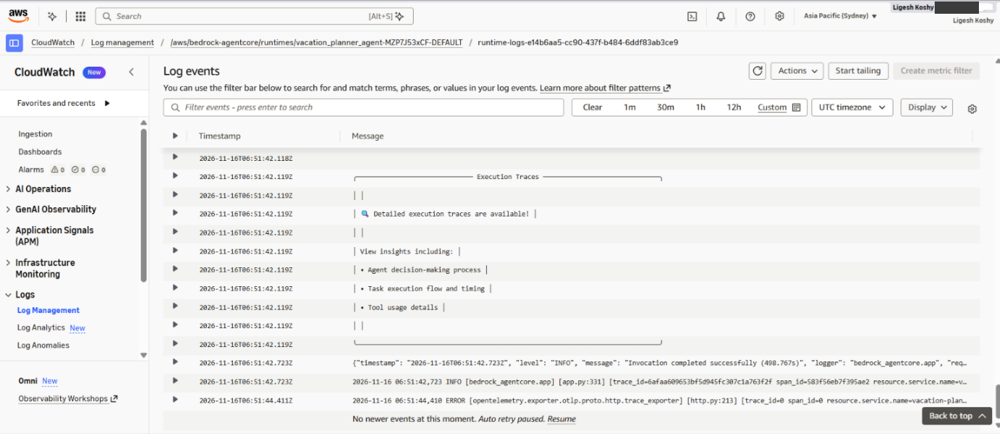
</details>

## 9. Roadmap

- Move the deployed model back to Bedrock (Nova or Claude) once quota allows, for faster and stronger tool use.
- Feed AgentCore Memory history into the prompts, use a stable per-user session ID, and add long-term preference memory.
- Discover tools dynamically from the Gateway's `tools/list`, and cache Cognito tokens until they expire.
- Tighten IAM to least privilege (`dynamodb:GetItem` only for the tool Lambda; only `lambda:InvokeFunction` for the gateway role).
- Infrastructure as code (CDK or Terraform) and a CI pipeline for build, push and runtime update.
- More tools behind the same gateway: weather, flights and hotels.

## Run it yourself

Local runs, the container, AWS deployment steps and environment variables are covered in **[docs/05-setup-and-deployment.md](docs/05-setup-and-deployment.md)**.

```
src/vacation_planner/crew.py         AgentCore entrypoint, agents, Gateway + Memory helpers
src/vacation_planner/config/         agents.yaml, tasks.yaml (tool routing)
src/vacation_planner/tools/          SerperSearchTool
src/lambda/                          tool Lambda, invoker Lambda, MCP tool schema
src/GWTEST/gwtest.py                 Cognito + MCP smoke test (tools/list, tools/call)
streamlitui.py                       UI (4 backend modes)
Dockerfile · deploy.ps1              arm64 image with self-hosted LLM → ECR
```
