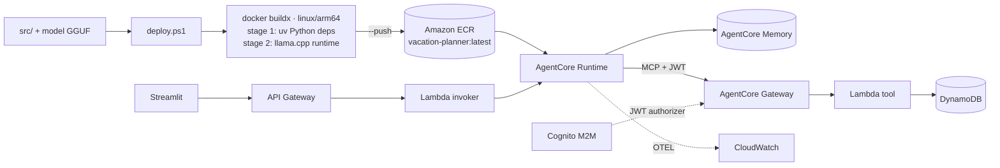

# 5. Setup and deployment

[← Back to README](../README.md)

## Prerequisites

* Python 3.11+, [`uv`](https://docs.astral.sh/uv/) and the CrewAI CLI (`uv tool install crewai`).
* Docker Desktop and the AWS CLI.
* A [Serper](https://serper.dev) API key.

```powershell
copy .env.example .env      # fill in your own values; .env is git-ignored
crewai install
```

## Run locally

| Mode | Command | Notes |
|---|---|---|
| Crew from the CLI | `crewai run` | Uses Ollama (`MODEL=ollama/qwen2.5:0.5b`, `OLLAMA_API_BASE`) and writes `report.md` |
| UI with the crew in-process | `uv run streamlit run streamlitui.py` | Leave `API_GATEWAY_URL`, `AGENTCORE_RUNTIME_ARN` and `AGENT_URL` empty |
| Production container | see below | Set `AGENT_URL=http://localhost:8080` to drive it from the UI |
| Gateway smoke test | `uv run python src/GWTEST/gwtest.py` | Cognito token, then `tools/list`, then `tools/call {"city": "Mumbai"}` |

To run the production container locally:

```powershell
curl -L -o models/qwen2.5-0.5b-instruct-q4_k_m.gguf `
  https://huggingface.co/Qwen/Qwen2.5-0.5B-Instruct-GGUF/resolve/main/qwen2.5-0.5b-instruct-q4_k_m.gguf
docker buildx build --platform linux/amd64 -t vacation-planner --load .
docker run --rm -p 8080:8080 --env-file .env -e OTEL_SDK_DISABLED=true vacation-planner
curl -X POST http://localhost:8080/invocations -H "Content-Type: application/json" -d '{"topic":"Tokyo, Japan"}'
```

## Deploy to AWS



The editable source is [`images/03-deployment.mmd`](images/03-deployment.mmd).

1. **DynamoDB.** Create the table `travel_packages` with partition key `city` (String) and load the package items.
2. **Tool Lambda.**
   * Deploy `src/lambda/lambdatravel_package_getdata.py` and set `TRAVEL_PACKAGES_TABLE`.
   * Grant `dynamodb:GetItem` and raise the timeout.
3. **Cognito.**
   * Create a user pool with a **Machine-to-machine** application (client credentials, with a client secret).
   * Note the client ID, the client secret and the token URL.
4. **AgentCore Gateway.**
   * Set inbound auth to **JWT**, using the Cognito OpenID discovery URL and the allowed client.
   * Add a **Lambda target** named `target-travel-agent-tool`, with the inline schema from `src/lambda/openAPI_schema.json`.
   * Check it with `gwtest.py`.
5. **AgentCore Memory.** Create a memory resource and note its ID.
6. **Image.** Run `.\deploy.ps1`, after setting `$ACCOUNT` and `$REGION` for your account. It builds the linux/arm64 image and pushes it to ECR.
7. **AgentCore Runtime.**
   * Create the runtime from the ECR image URI and set the environment variables below.
   * Give the execution role permission to pull from ECR, write to CloudWatch and X-Ray, and call `bedrock-agentcore:ListEvents` and `bedrock-agentcore:CreateEvent`.
8. **Public API.**
   * Deploy `src/lambda/lambda_function.py` with `AGENT_RUNTIME_ARN` and `AGENT_RUNTIME_QUALIFIER`.
   * Grant it `bedrock-agentcore:InvokeAgentRuntime`.
   * Put an API Gateway REST `POST` resource in front of it.
9. **Observability.** Enable CloudWatch Transaction Search and, if you use Bedrock models, model invocation logging.
10. **UI.** Set `API_GATEWAY_URL` and run Streamlit.

## Environment variables

The template is [`.env.example`](../.env.example), which contains placeholders only.

| Variable | Used by | Purpose |
|---|---|---|
| `MODEL`, `OLLAMA_API_BASE` / `LLM_BASE_URL` | `crew.py` | LLM provider/model and endpoint |
| `Serper_API_KEY` | `tools/custom_tool.py` | Web search |
| `AWS_REGION` | `crew.py`, `streamlitui.py` | Region |
| `AGENTCORE_MEMORY_ID` | `crew.py` | AgentCore Memory resource |
| `COGNITO_CLIENT_ID`, `COGNITO_CLIENT_SECRET`, `COGNITO_TOKEN_URL` | `crew.py`, `gwtest.py` | OAuth client credentials |
| `GATEWAY_URL`, `GATEWAY_TOOL_NAME`, `MCP_PROTOCOL_VERSION` | `crew.py`, `gwtest.py` | MCP endpoint, namespaced tool, protocol header |
| `API_GATEWAY_URL` / `AGENTCORE_RUNTIME_ARN` / `AGENT_URL` | `streamlitui.py` | Backend selection (first one set wins) |
| `AGENT_RUNTIME_ARN`, `AGENT_RUNTIME_QUALIFIER` | invoker Lambda | Target runtime (Lambda environment variables) |
| `TRAVEL_PACKAGES_TABLE` | tool Lambda | DynamoDB table (Lambda environment variable) |

## Further notes

* [01 – CrewAI concepts](01-crewai-concepts.md)
* [02 – Implementation guide](02-implementation.md)
* [03 – Switching to a local LLM](03-local-llm-ollama.md)
* [04 – Troubleshooting log](04-troubleshooting.md)
